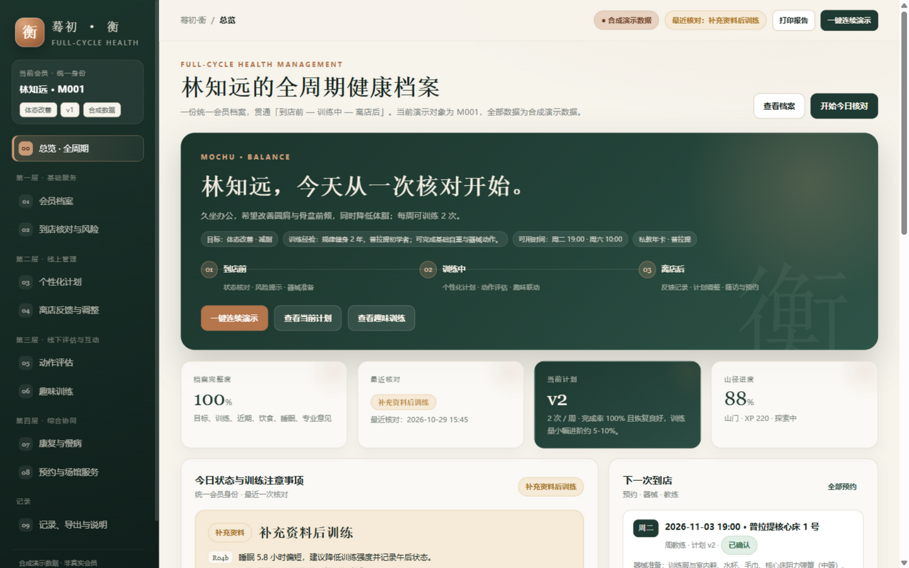
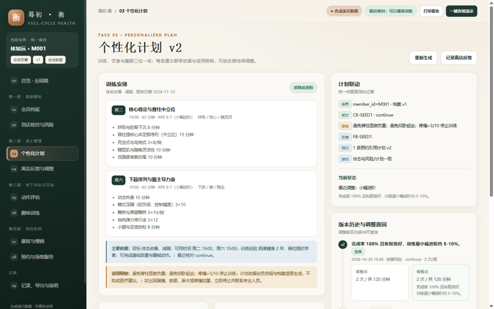
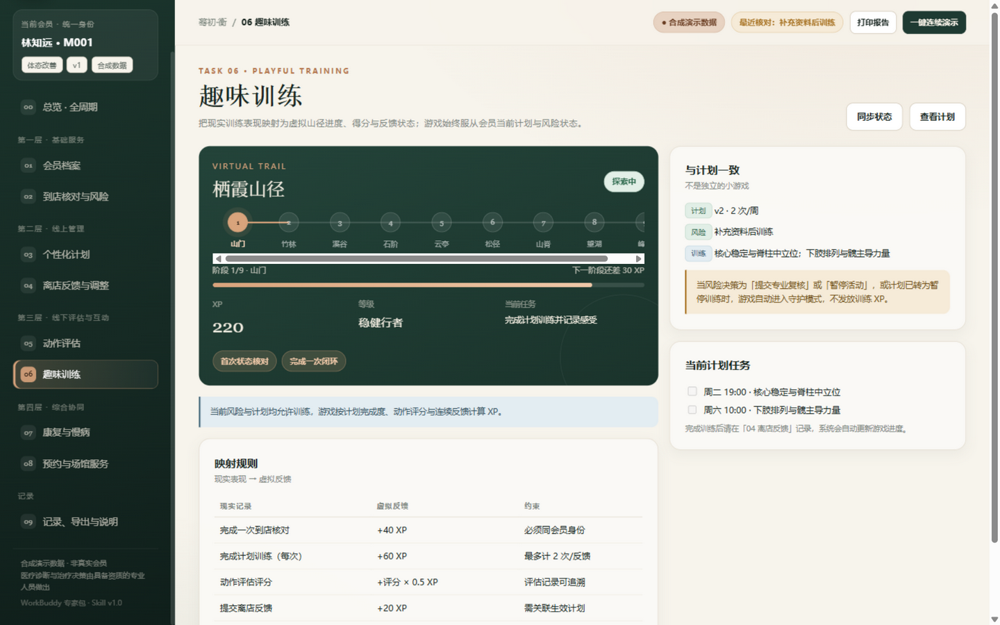

# 蓦初·衡 · 全周期健康管理智能体（演示界面）

> 2026「AI 赋能·三旋翼驱动」旋创赛参赛作品的前端演示面板。
> 纯 HTML / CSS / JavaScript，无第三方依赖、无需联网，双击即可运行。

「蓦初·衡」面向高端健身与运动康养场景，用一份统一的会员档案贯通会员的「到店前 — 训练中 — 离店后」：状态核对与风险提示、训练/饮食/睡眠计划、离店反馈与计划调整、动作评估、趣味训练、康复/慢病守护、预约协同。

本仓库是该作品的**界面层**：一个可离线运行的演示面板（合成数据），与 WorkBuddy 专家包使用同一套业务规则。

## 功能一览

| 页面 | 内容 |
|---|---|
| 00 总览 | 全周期视图、当前会员、风险状态、一键连续演示 |
| 01 会员档案 | 目标、训练经验、近期运动、饮食、睡眠、诊断/医嘱；版本历史 |
| 02 到店核对 | R01–R09 风险规则，决策优先级：暂停 > 专业复核 > 补充资料 > 继续 |
| 03 个性化计划 | 训练 + 饮食 + 睡眠，附依据与限制 |
| 04 离店反馈 | 完成率、疲劳、睡眠、疼痛摘要，计划版本 diff |
| 05 动作评估 | 关节角度 CSV → 动作周期识别 → ROM / 节奏 / 左右对称 / 躯干稳定 + 评分 |
| 06 趣味训练 | 现实表现映射山径进度、XP、徽章；风险触发守护模式 |
| 07 康复与慢病 | 专业意见、限制校验、随访；越界请求拒绝 |
| 08 预约与服务 | 预约/改约/取消/完成，器械与教练分配、准备清单 |
| 09 记录与导出 | 审计记录、会员 JSON 导出、说明 |

## 运行

方式一：直接双击 `index.html`（离线可用）。

方式二：本地服务器

```bash
python -m http.server 8765
# 打开 http://127.0.0.1:8765
```

点击右上角「一键连续演示」，会用同一会员 M001 连续走完 8 项任务。

## 截图







更多截图见 [screenshots/](screenshots/)（13 张，覆盖全部页面与关键弹窗）。

## 说明

- 演示数据全部为**合成数据**，不含真实个人信息。
- 健康建议不构成医疗建议；医疗诊断与治疗决策由具备资质的专业人员做出。
- 本仓库仅包含界面前端；WorkBuddy 专家包（Agent + Skill + CLI）与商业/文案资料不在本仓库。
- 参赛作品，仅用于展示与交流；未经授权请勿用于商业用途。
